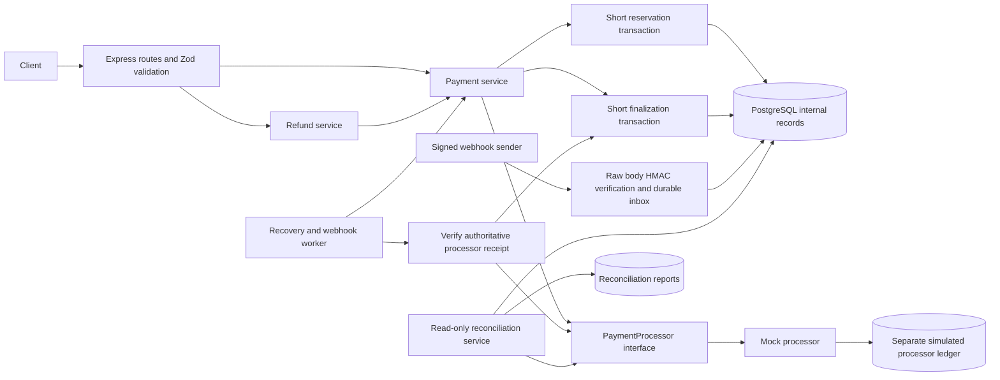
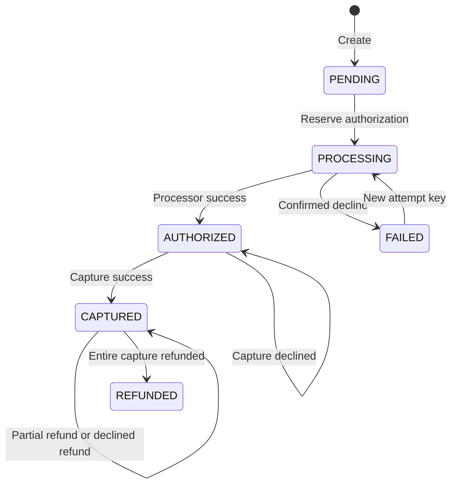

# Payment Processing Engine

A standalone TypeScript/Express payment backend demonstrating durable idempotency, PostgreSQL locking, recoverable processor operations, signed webhooks, partial refunds, and reconciliation. **It only simulates payments. No real money, payment credentials, card numbers, or CVV are accepted.**

Node 24 LTS, Express 5, Prisma 7 with the PostgreSQL driver adapter, strict TypeScript, Zod, Pino, Vitest, and OpenAPI 3.0.3. Exact dependency versions are in `package.json` and `package-lock.json`.

## Quick start

### Docker Compose

Run these commands from `payment-processing-engine/`.

```bash
npm run env:init  # generates secrets only if .env does not already exist
docker compose up --build -d --wait
docker compose exec app npm run db:seed
curl http://localhost:3000/api/v1/health
```

Compose starts PostgreSQL 17, waits for readiness, runs the migration job, then starts the API with its background recovery worker. Host ports bind to localhost. The PostgreSQL bootstrap credentials are local demo values. The API uses a separate `payment_app` role and a generated password; the migration job configures its table permissions. Webhook secrets are generated by `env:init`, and Compose requires an explicit value. Open **http://localhost:3000/docs/** for Swagger UI, or **http://localhost:3000/openapi.json** for the specification.

```bash
docker compose logs -f app
docker compose down          # keeps database volume
```

The initial database script also creates `payment_engine_test`. If reusing an older volume without that database, create it with `docker compose exec postgres createdb -U payment_demo payment_engine_test`.

### Local Node with PostgreSQL

Requires Node **24.11+ on the 24 LTS line**, npm, and PostgreSQL. Use PostgreSQL 17 for new installations.

```bash
npm run env:init  # generates secrets only if .env does not already exist
npm ci
npm run db:generate
docker compose up -d --wait postgres  # or use your own local PostgreSQL server
npm run db:migrate
npm run db:roles
npm run db:seed
npm run dev
```

Set `DATABASE_URL` and `TEST_DATABASE_URL` to your own databases if not using Compose. If port 5432 is occupied, set `POSTGRES_PORT` to a free host port and use that same port in both URLs. The implementation workspace uses port 55433 to avoid an existing service; the example defaults to 5432. `HOST` defaults to `127.0.0.1`. The API and the recovery worker run in one process; multiple API processes are safe with the simulated processor's shared durable ledger.

Production compilation and startup:

```bash
npm run typecheck
npm run build
npm start
```

The runtime image runs as the non-root `node` user. It includes migration/seed tools for this demo; a production deployment would normally use separate migration and runtime images.

## Architecture



Routes handle validation and HTTP responses. Services own business rules; `PaymentProcessor` isolates the processor contract. Prisma is injected into services rather than hidden behind redundant CRUD repositories. `database/locks.ts` centralizes the transaction locking primitives. No external call runs inside a merchant database transaction.

```text
payment-processing-engine/
├── prisma/
│   ├── schema.prisma
│   ├── migrations/  # schema, constraints, and webhook claim token
│   └── seed.ts
├── src/
│   ├── app.ts, server.ts, worker.ts
│   ├── config/env.ts
│   ├── database/client.ts, locks.ts
│   ├── middlewares/error-handler.ts
│   ├── modules/
│   │   ├── payments/payment-service.ts
│   │   ├── refunds/refund-service.ts
│   │   ├── processors/payment-processor.ts, mock-processor.ts
│   │   ├── webhooks/webhook-service.ts
│   │   └── reconciliation/reconciliation-service.ts
│   ├── routes/openapi.ts
│   ├── shared/errors.ts, logger.ts, utils.ts
│   └── tests/setup.ts, payment-engine.test.ts
├── scripts/
│   ├── prepare-test-db.ts, init-test-db.sql
│   ├── send-webhook.ts, retry-webhook.ts
├── .github/workflows/ci.yml
├── Dockerfile, docker-compose.yml
├── .env.example
├── tsconfig.json, tsconfig.check.json, vitest.config.ts
└── package.json, package-lock.json
```

## Lifecycle and retry semantics



Capture is full-amount only. Pending capture operations leave the payment `AUTHORIZED`; the operation row carries the pending state. Pending refunds leave the payment `CAPTURED` and reserve refundable funds. A payment becomes `REFUNDED` only when successful refunds total the entire capture.

Each processor operation has a stable UUID and a `PENDING`, `SUCCEEDED`, or `FAILED` outcome. Receipt validation binds the response to that exact UUID, payment, type, amount, and currency, with runtime schema validation before finalization. A **network timeout is not a decline**:

1. Reserve an operation in a short database transaction and commit.
2. Call `PaymentProcessor.execute` with that operation UUID outside the transaction.
3. Finalize the authoritative outcome under the payment row lock in another transaction.
4. If the process crashes or loses the response after processor success, the operation stays pending. A client retry or worker reuses its UUID and gets the original processor receipt.

The mock serializes its own ledger writes per payment/type, making the retry-once fixture deterministic under concurrent refunds. These short processor-ledger transactions are separate from merchant transactions. The mock stores its receipts in `processor_records` using PostgreSQL `INSERT ... ON CONFLICT DO NOTHING` through Prisma `createMany(skipDuplicates)`. Concurrent processor calls can occur, but only one financial receipt is stored. This is an **at-least-once execution protocol with idempotent financial effects**, not a claim of exactly-once network delivery.

A confirmed failure is terminal for that operation UUID. Retrying its key returns the same failed result. Use a **new `Idempotency-Key`** to explicitly request a new authorization, capture, or refund attempt. Failed authorization permits reauthorization; failed capture leaves authorization intact; failed refund releases its reservation. A new key cannot bypass an unresolved authorization/capture. Unknown refund outcomes keep their amount reserved.

Authorization/capture keys are optional for convenience; absent keys use `default`. Prefer explicit keys. Creation/refund keys are mandatory. Creation keys are global in this single-merchant demo; operation keys are scoped by payment and action. Keys have no expiry, so deleting them would require a carefully defined retention policy.

Mock payment method references:

| Reference              | Behavior                                                              |
| ---------------------- | --------------------------------------------------------------------- |
| `pm_mock_ok`           | All operations succeed                                                |
| `pm_mock_decline`      | Authorization declines                                                |
| `pm_mock_capture_fail` | Authorization succeeds, capture declines                              |
| `pm_mock_refund_fail`  | Authorization/capture succeed, refunds decline                        |
| `pm_mock_retry_once`   | First attempt of each operation type declines; a new attempt succeeds |

Only these references are accepted. Test adapters inject timeouts without enabling fault-injection controls on the HTTP API.

## Schema and invariants

Every table uses a UUID primary key and creation/update timestamps. Prisma generates UUIDs and manages `updatedAt` for application writes. Direct SQL writers must supply IDs and manage timestamps themselves.

| Table                    | Purpose and protections                                                                                                                       |
| ------------------------ | --------------------------------------------------------------------------------------------------------------------------------------------- |
| `customers`              | Seeded customer identity; payments have an FK                                                                                                 |
| `payments`               | Unique reference; integer amounts, status, capture/refund totals; customer/time and status indexes                                            |
| `refunds`                | Payment and transaction FKs; unique operation association; amount and outcome history                                                         |
| `idempotency_keys`       | Unique key, canonical request hash, original response and HTTP status                                                                         |
| `payment_transactions`   | Durable authorization/capture/refund attempts; unique operation key; pending-work index                                                       |
| `webhook_events`         | Unique external event ID, validated payload/hash, attempts, retry time, outcome; queue index                                                  |
| `reconciliation_records` | Immutable-by-service reconciliation reports; creation-time index                                                                              |
| `processor_records`      | Separate simulated processor ledger with unique operation UUID; intentionally no internal FK so missing internal transactions can be detected |

Money uses positive integer minor units, capped at 2,000,000,000 per payment. USD/EUR/GBP/INR are supported; all use two decimal places. No floating-point multiplication or division is used for money. Database checks enforce nonnegative balances, `refundedAmount <= capturedAmount <= amount`, positive amounts, currency, and payment status/balance consistency.

A partial unique index allows at most one pending or successful authorization/capture per payment/type. Failed attempts do not consume that slot. A composite FK binds refund ownership to its transaction. Deferred constraint triggers reject mismatched type, amount, or status at commit, while permitting atomic finalization of both rows. Missing refund rows are reported by reconciliation. Cross-row refund sums are protected by service transactions and a shared payment row lock; database checks additionally prevent invalid stored payment totals. Arbitrary privileged SQL can still bypass cross-table business rules. Production database roles should restrict direct financial writes.

Use **migrations**, not `prisma db push`: custom SQL checks and the partial unique index are part of the migration and are not fully represented by the Prisma schema.

## Idempotency and locking

Creation normalizes input with Zod into a fixed object shape and hashes that shape with SHA-256. Equivalent JSON property ordering has the same hash. Unknown fields are rejected. A transaction-scoped PostgreSQL advisory lock serializes requests for the same creation key, including the period before any row exists. The payment and stored response commit together. Identical repeats return the original JSON and HTTP 201, even if the payment has since progressed; a different payload returns 409. A database unique constraint remains the final safeguard.

Financial mutations use PostgreSQL **READ COMMITTED** transactions with `SELECT ... FOR UPDATE` on the parent payment row. Every reservation/finalization follows that lock order. Once acquired, the transaction rereads current state; all refund reservations for that payment serialize on the same row. Available refund balance is:

```text
capturedAmount - refundedAmount - sum(PENDING refund amounts)
```

No lock is retained while a processor call is in progress. Finalization checks the receipt against the expected operation ID, payment ID, operation type, currency and amount, then commits payment totals, refund outcome, and operation outcome atomically. Already completed operations are no-ops, so duplicate callbacks cannot reapply money. A failure anywhere rolls back the whole transaction. Retryable HTTP 503 errors require retrying the same key. A receipt mismatch returns 502 with `retryable: false`, retains the financial reservation, and blocks automatic operation recovery until investigated. A manual retry with the original key can resolve the operation once the adapter is corrected. Data integrity errors are non-retryable 500 responses. No timeout is converted into a decline.

## Webhooks

`POST /api/v1/webhooks/processor` uses Express's raw body middleware **before** the JSON parser. The signature is lowercase hex HMAC-SHA256 of:

```text
timestamp + "." + exact raw request body bytes
```

`X-Processor-Timestamp` is Unix time in seconds with a ±300-second window. Comparison uses `timingSafeEqual` after strict format validation. Reformatting or changing whitespace changes the signature. Compressed webhook bodies are rejected so signatures always refer to transmitted JSON bytes. The receiver persists the validated event before returning 202. Duplicate event IDs with identical normalized content are accepted; conflicting content returns 409.

The background worker claims due events using an atomic conditional update and a 30-second lease. A fresh UUID claim token fences final status updates, including across explicit operator retries. Processor lookups have deadlines. Non-retryable receipt mismatches dead-letter immediately with a safe error code; transient processing failures use exponential backoff (capped at five minutes), and mark the event `DEAD` after eight failed attempts. A crashed worker's lease expires so another worker can resume. Finalizing the financial operation and marking the inbox event processed are separate commits: a crash between them safely replays the already completed operation.

The worker verifies the event against an authoritative processor receipt rather than directly assigning the webhook's claimed status. This prevents delayed authorization/capture/failed-attempt events from regressing a refunded or successfully retried payment. Unavailable processor receipts retry and eventually dead-letter. Missing internal operations and invalid receipts require investigation and dead-letter immediately; they never create payments. The event history endpoint exposes processing status and attempts.

Send an event for an existing processor operation (UUID returned by authorize/capture or `transactionId` in a refund):

```bash
npm run webhook:send -- OPERATION_UUID demo-event-1
npm run webhook:send -- OPERATION_UUID demo-event-1  # duplicate delivery
npm run webhook:retry -- demo-event-1               # explicit failed/dead replay
```

The CLI signs the actual transmitted bytes with `WEBHOOK_SECRET`. Explicit replay is a local operator command, not an unauthenticated admin HTTP endpoint.

## Refunds

Send a positive amount and a unique idempotency key. Refunds require a captured payment and reserve balance before contacting the processor. Use the full remaining amount for a full refund or a smaller amount for a partial refund. Concurrent distinct requests cannot exceed captured funds; identical keys return the same refund. Changed amounts with the same key conflict. A pending or unknown refund retains its reservation; only a confirmed failed refund releases it. History includes pending, successful and failed attempts.

## Reconciliation

`POST /api/v1/reconciliation/run` compares the processor ledger with an internal **REPEATABLE READ** snapshot of payments, transactions, and refunds. It records missing transactions on either side, missing/mismatched refunds, missing supporting authorization/capture operations, status/amount/metadata mismatches, and payment capture/refund total/status discrepancies. Unsupported states are discrepancies rather than their own expected values. Reports include counts and timestamps and are available through the paginated report endpoint.

Reconciliation **never modifies financial records**. There is deliberately no generic “auto-fix” endpoint: an operator must investigate, then use an appropriate explicit business operation. Since processor and merchant snapshots are not globally atomic, running during active processing can report transient differences; rerun after operations settle. Processor records are fetched in pages of 200. Each input table/ledger is capped at 2,000 records; exceeding the ceiling returns `RECONCILIATION_LIMIT_EXCEEDED` without saving a partial report. Processor scanning has a 30-second budget checked between bounded calls; database snapshots have a 15-second timeout. One run per service instance is allowed (429 for overlap). The demo deliberately refuses oversized histories rather than silently omitting records; production reconciliation needs bounded settlement windows, pagination, durable checkpoints, currency-aware settlement accounting, and human-approved correction workflows.

## API

All endpoints use `/api/v1`. IDs must be UUIDs. Paginated endpoints accept `page` (default 1) and `limit` (default 20, max 100) and return `{ data, total, page, limit }`.

| Method | Path                      | Success | Notes                                                                            |
| ------ | ------------------------- | ------- | -------------------------------------------------------------------------------- |
| POST   | `/payments`               | 201     | Required `Idempotency-Key`; amount, currency, customerId, paymentMethodReference |
| GET    | `/payments/:id`           | 200     | Current payment state                                                            |
| POST   | `/payments/:id/authorize` | 200     | Optional attempt key; empty body                                                 |
| POST   | `/payments/:id/capture`   | 200     | Optional attempt key; empty body                                                 |
| POST   | `/payments/:id/refunds`   | 201     | Required key; `{ "amount": 300 }`                                                |
| GET    | `/payments/:id/refunds`   | 200     | Paginated refund history                                                         |
| POST   | `/webhooks/processor`     | 202     | Signed raw JSON event                                                            |
| GET    | `/webhooks/events`        | 200     | Paginated event history                                                          |
| GET    | `/health`                 | 200     | Checks PostgreSQL connectivity                                                   |
| POST   | `/reconciliation/run`     | 201     | Persist a report; empty body                                                     |
| GET    | `/reconciliation/reports` | 200     | Paginated reports                                                                |

Validation errors return 400, invalid/expired signatures 401, missing resources 404, state/idempotency conflicts 409, oversized bodies 413, missing customers or confirmed processor declines 422, non-retryable internal/integrity errors 500, invalid processor receipts 502, and transient failures 503. Overlapping reconciliation runs return 429. Error envelopes include a `retryable` flag. Declines return the operation or refund outcome for inspection; other failures use the common error envelope. Request IDs appear in responses and structured logs.

```json
{
  "error": {
    "code": "CONFLICT",
    "message": "Refund exceeds available captured amount",
    "retryable": false,
    "requestId": "request-uuid"
  }
}
```

### Example requests

The seed customer ID is stable:

```bash
curl -sS -X POST http://localhost:3000/api/v1/payments \
  -H 'Content-Type: application/json' \
  -H 'Idempotency-Key: order-1001' \
  -d '{"amount":1000,"currency":"USD","customerId":"11111111-1111-4111-8111-111111111111","paymentMethodReference":"pm_mock_ok"}'
```

Example response (IDs/timestamps vary):

```json
{
  "id": "29e22fcf-f7d9-4efc-83c8-2fa064807621",
  "reference": "pay_38353fb4-b34f-4ad1-aeea-cb7e2a44e4e0",
  "amount": 1000,
  "currency": "USD",
  "customerId": "11111111-1111-4111-8111-111111111111",
  "paymentMethodReference": "pm_mock_ok",
  "status": "PENDING",
  "capturedAmount": 0,
  "refundedAmount": 0,
  "createdAt": "2026-11-05T18:00:00.000Z",
  "updatedAt": "2026-11-05T18:00:00.000Z"
}
```

Use the returned payment ID:

```bash
PAYMENT_ID=replace-with-returned-uuid
curl -sS -X POST "http://localhost:3000/api/v1/payments/$PAYMENT_ID/authorize" -H 'Idempotency-Key: auth-1'
curl -sS -X POST "http://localhost:3000/api/v1/payments/$PAYMENT_ID/capture" -H 'Idempotency-Key: capture-1'
curl -sS -X POST "http://localhost:3000/api/v1/payments/$PAYMENT_ID/refunds" \
  -H 'Content-Type: application/json' -H 'Idempotency-Key: refund-1' -d '{"amount":300}'
curl -sS "http://localhost:3000/api/v1/payments/$PAYMENT_ID/refunds?page=1&limit=20"
curl -sS -X POST http://localhost:3000/api/v1/reconciliation/run
```

## Testing

Tests require a **real, dedicated PostgreSQL database**; repositories are not mocked. The test setup refuses a database name that does not end in `_test`. Each test truncates demo tables in that database. Never point it at shared data.

```bash
npm ci
npm run db:generate
npm run test:db:prepare
npm run typecheck
npm test
npm run build
```

A GitHub Actions workflow runs migrations, typechecking, tests, and compilation against PostgreSQL 17 on push/pull request. It is provided but has not been executed on GitHub as part of this local implementation.

The suite uses concurrent HTTP requests and multiple independent service/processor instances sharing PostgreSQL. It verifies exact financial row counts and balances, not just HTTP success codes. Tests cover creation/replay/conflicts, simultaneous authorization/capture/refunds, worker overlap, success followed by response loss, reservations during unknown outcomes, confirmed-failure retries, partial/full/over-refunds, raw-byte signatures, duplicate and out-of-order events, backoff/dead-letter/replay, database constraints, trigger-injected rollback, and reconciliation discrepancies. The rollback tests use temporary PostgreSQL triggers and remove them in `finally` blocks.

## Production boundaries

- This is a local portfolio demo, not a deployable payment gateway. It lacks authentication, merchant/tenant isolation, authorization policies, rate limiting and public-facing abuse controls. Keep it bound to localhost until those are added.
- No PCI-sensitive data is accepted. A real integration must use processor tokenization, compliance-reviewed data handling, credential storage/rotation, authenticated APIs, and signed provider-specific webhooks.
- The mock ledger lives in the same PostgreSQL database but uses separate commits and no internal FK. A real processor is a separate system with its own availability, settlement and idempotency guarantees. The interface requires durable idempotency by operation UUID; without that guarantee, uncertain results need provider lookup and manual reconciliation before retrying.
- Operation recovery claims due pending rows in batches of 50 with a 120-second lease, exponential backoff capped at five minutes, and a matching recovery index. Calls have a configurable deadline (default five seconds) and bounded execution/read concurrency (five each), with queues capped at 100. Slots remain occupied until the actual adapter promise settles, even if it ignores abort; a non-cooperative adapter can exhaust its own capacity and requires intervention. Recovery and webhook schedulers run independently. Real adapters must honor AbortSignal and provide durable idempotency. Distributed rate limits, circuit breakers and external alert delivery remain deployment work. Never release reservations solely because a timeout elapsed.
- This demo has full capture only, no authorization expiry/voids, 3DS/SCA, chargebacks, disputes, fees, payout settlement, foreign exchange, or double-entry accounting ledger.
- Event workers use leases and bounded retries, but there is no external queue or dead-letter alert integration. Synchronized clocks and webhook secret rotation are operational requirements.
- Reconciliation is reporting-only and may observe transient mismatches during live traffic. Large-volume processing, immutable audit trails, archival, backups, least-privilege DB roles and operational monitoring remain production work.
- Pino logs request IDs, method/path, status, operation/event IDs and safe error codes/retryability. Request bodies, payment references, raw exceptions and secrets are not logged. Pagination is offset-based and can shift under concurrent inserts.

## Historical verification — 5 November 2026 (before review fixes)

These commands were actually executed in the implementation workspace:

| Check                                                          | Result                                                                                                |
| -------------------------------------------------------------- | ----------------------------------------------------------------------------------------------------- |
| `npm run db:generate`                                          | Prisma client generated                                                                               |
| `npm run db:migrate`                                           | Both migrations applied successfully; subsequent run had no pending migrations                        |
| `npm run test:db:prepare`                                      | Both migrations applied to the dedicated test database                                                |
| `npm run typecheck`                                            | Passed, including application, tests, scripts and configuration                                       |
| `npm test`                                                     | **37 passed, 0 failed** against real PostgreSQL 17.11; final run 5.49 seconds                         |
| `npm run build`                                                | Passed                                                                                                |
| `docker compose build` / `docker compose up --build -d --wait` | Images built; startup completed after configuring a free PostgreSQL host port                         |
| `docker compose exec -T app npm run db:seed`                   | Demo customer seeded                                                                                  |
| `docker compose ps -a`                                         | API and PostgreSQL healthy; migration job exited 0                                                    |
| Live HTTP lifecycle                                            | Creation → authorization → capture → 300-unit partial refund → 700-unit refund; final status REFUNDED |
| Live reconciliation                                            | Zero discrepancies after the lifecycle smoke test                                                     |
| Signed webhook sender                                          | HTTP 202; background processing verified                                                              |

Test breakdown: creation/validation **5**, authorization/capture/recovery **9**, refunds **6**, webhooks **11**, database integrity/reconciliation/API checks **6**. The suite also passed against the host's isolated PostgreSQL 12.22 instance during initial development; PostgreSQL 17 is the documented Docker target. That temporary host instance was stopped afterward.

The original workspace demo was available at **http://localhost:3000/docs/**. Its `.env` uses PostgreSQL host port **55433** because another service occupies 5432. Compose credentials are local demo credentials only. To stop this demo while preserving its records, run `docker compose down` from this project. The GitHub Actions workflow is supplied but has not been run remotely.

## Configuration and operator notes after review

- `DATABASE_URL` is the runtime connection; `MIGRATION_DATABASE_URL` is the privileged migration connection. `db:roles` uses the latter and grants only SELECT/INSERT/UPDATE on the eight application tables. Runtime cannot delete rows, change schema, manage roles, or alter migration history. Tests deliberately use a separate privileged test database for fault-injection triggers.
- `npm run env:init` creates a mode-0600 `.env` with random runtime/webhook secrets and never overwrites an existing file. When upgrading an existing configuration, add `MIGRATION_DATABASE_URL` and a generated `RUNTIME_DB_PASSWORD`, set `DATABASE_URL` to the `payment_app` account, then run migrations and `db:roles`. Keep all database URLs aligned with your chosen `POSTGRES_PORT`.
- `PROCESSOR_TIMEOUT_MS` defaults to 5000 and `PROCESSOR_CONCURRENCY` defaults to 5. An adapter receives an AbortSignal. Timeouts retain pending reservations; inspect `lastErrorCode`, `attempts`, `nextAttemptAt`, and `recoveryBlocked` on operation records. A pending operation with a permanent receipt/integrity error requires investigation; do not replace it with a new operation key.
- Mock payment-method validation lives in the mock adapter. Core requests accept opaque references, and other adapters can provide their own reference validator.
- Refund/event/report pagination uses REPEATABLE READ for consistent data/count snapshots. Offset pagination can still shift between separate requests.
- The API remains an unauthenticated, single-merchant local demo. These changes do not implement H4's authentication/tenant isolation requirements and do not establish production readiness. Reconciliation admission control and processor concurrency limits are per process, not a distributed rate limiter.

## Review-fix verification — 6 November 2026

The final source passed **54 PostgreSQL integration tests, 0 failures, 0 skipped** (`npm test`, 6.96 seconds). `npm run typecheck`, `npm run format:check`, and `npm run build` also passed. All five migrations were applied to both development and test databases; subsequent migration runs found nothing pending.

Regression coverage now includes wrong-operation/wrong-payment/malformed receipts, missing and inconsistent refund history, missing supporting authorizations, database refund constraints, processor deadlines and abort, recovery backoff, bounded concurrency (including an adapter ignoring abort), independent worker clients with separate PostgreSQL pools, a child process exiting after processor success, independently calculated HMACs, safe error logging, and reconciliation capacity/admission limits. Existing creation, authorization, capture, refund, webhook, and rollback cases remain in the suite.

The runtime role was verified directly: `payment_app` is not a superuser, cannot create databases/roles/schema objects, cannot delete payments, and cannot modify migration history. `env:init` was run against the existing environment and preserved it.

### Second review outcome

- H1–H3 and the approved medium/low fixes are implemented. Receipt validation occurs against the requested operation; reconciliation retains discrepancy values and now audits refund/supporting-operation evidence; recovery and webhook scheduling are independent with bounded calls and retries.
- The second review corrected transient database-error classification, made role provisioning transactional, corrected PostgreSQL index-name truncation with a migration, and preserved idempotent responses when adapter validation policies change.
- H4 remains unresolved: authentication, authorization and merchant isolation are not implemented. Keep the API local. This is a payment-processing demo, not a production-ready gateway.
- Concurrency and reconciliation admission controls are per process. There is no distributed rate limiter or external alert delivery. An adapter ignoring abort retains its occupied slots; this bounds resource use but can require adapter repair/restart. Unknown financial outcomes remain reserved.
- Reconciliation rejects histories above its documented cap instead of producing incomplete reports. It can still observe transient differences across independently changing processor/internal snapshots. Historical audit retention and production settlement workflows remain outside this demo.
- Crash testing covers process exit after processor commit and injected database rollback; it does not simulate host power loss, PostgreSQL failover, or every possible termination boundary. GitHub CI has not been run remotely.

The review fixes were verified before preparing the initial Git history. Publication is for a local simulation demo; H4 remains an explicitly documented limitation.

The final Prisma schema comparison returned an empty migration. The rebuilt-container smoke test completed idempotent creation, authorization, capture, partial/full refunds, and duplicate signed webhook processing with zero reconciliation discrepancies. The API and PostgreSQL health checks passed.
